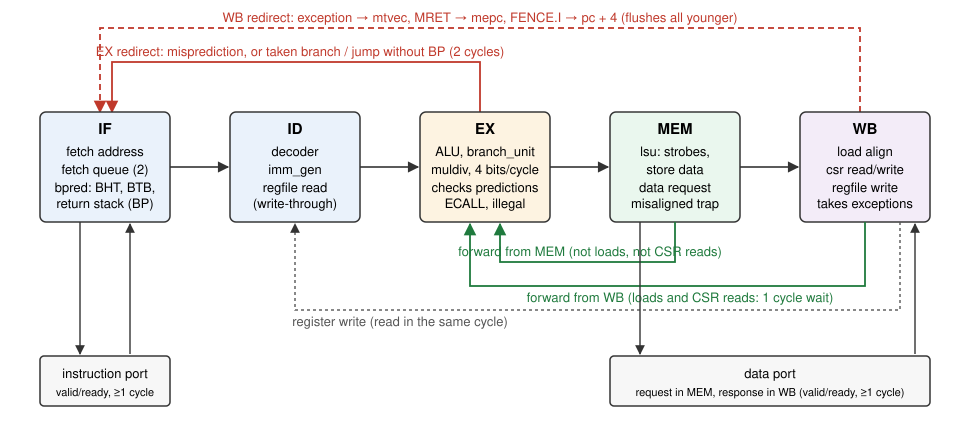

# arp273

RV64 SoC: CPU, vector unit and SIMT GPU
> **Status: work in progress.** Stage 1 (the RV64IM core) is complete and released as [v0.1.0](https://github.com/Den-Kachanov/arp273/releases/tag/v0.1.0); stage 2 (SoC, FPGA) is next.

1. **CPU:** RV64IM core, 5-stage pipeline, M-mode CSRs and precise exceptions, caches, FPGA bring-up, CoreMark.
2. **Vector unit:** subset of RVV 1.0 (Zve32x, VLEN = 128 as a parameter), checked against Spike.
3. **GPU:** SIMT, [Vortex](https://github.com/vortexgpgpu/vortex)-style (a RISC-V core per thread with thread-control instructions), driver, MNIST and 3D cube demos. Inspired by Vortex, no code reused.

No third-party RTL is used.



## Current state

- RV64IM (also builds as RV32IM with `XLEN = 32`), 5-stage pipeline: forwarding, 1-cycle load-use, 2-cycle taken branch, iterative multiplier/divider
- valid/ready memory ports that tolerate any latency (tested against randomly stalling memories)
- M-mode CSRs, precise exceptions taken in WB, ECALL, EBREAK, MRET, FENCE.I
- `riscv-tests` rv64ui-p and rv64um-p: 66/66 pass (`ma_data` not run: misaligned access traps)
- Commit log matches Spike on C programs and on random programs
- Mutation-tested unit tests (cocotb), lint and structural checks (no latches, loops, async resets) in CI

Measured 2026-11-25/26 on the RTL of commit `3c7be96` (unchanged in v0.1.0), Yosys 0.66; area figures are estimates:

| | |
|---|---|
| CPI on a 1-cycle BRAM | fib 1.141, alu 1.103, mem 1.216 |
| Area, XLEN = 64 (generic LUT6) | 5920 LUT6, 4000 flip-flops (release build: 5907 / 3741) |
| Fmax | pending FPGA place-and-route |

The core's contract is in [docs/spec.md](docs/spec.md), the verification plan and its results in [docs/verification.md](docs/verification.md). Design decisions are recorded in [docs/adr](docs/adr), module descriptions in [docs/modules](docs/modules/overview.md), diagrams generated from the RTL in [docs/diagrams.md](docs/diagrams.md).

## Roadmap

- [x] Stage 1: RV64IM core, single-cycle reference and 5-stage pipeline, CSRs and exceptions, `riscv-tests`, Spike comparison
- [ ] Stage 2: timer and interrupts, SoC bus, UART, FPGA, CoreMark, 4 KB cache, `riscv-arch-test`
- [ ] Stage 3: vector unit, Zve32x
- [ ] Stage 4: GPU specification and SIMT core in simulation
- [ ] Stage 5: integration, driver, MNIST and 3D cube demos
- [ ] Stage 6: report and write-up

## Verification approach

- Module tests with cocotb, including edge cases (0, -1, smallest and largest values); mutation checks of the tests (220 mutants, 216 killed, 4 equivalent).
- Commit-log comparison against [Spike](https://github.com/riscv-software-src/riscv-isa-sim) (`--log-commits`), stopping at the first mismatch.
- Compliance: `riscv-tests` rv64ui-p and rv64um-p in CI; later `riscv-arch-test` via RISCOF.
- Random program generator with saved seeds.
- Random initial register state in every simulation, as on silicon.
- Later: SymbiYosys / riscv-formal.

Performance figures are published only from measurements, with the date (and the commit hash).

## Getting started

Needs Verilator 5, Yosys, a RISC-V GCC (`riscv64-elf-`), Spike, Python 3.12.

```sh
git clone --recursive https://github.com/Den-Kachanov/arp273.git
cd arp273
python -m venv .venv && .venv/bin/pip install -r requirements.txt
make lint unit                      # lint and unit tests
make compare PROG=fib CORE=pipe     # run a C program and compare with Spike
make riscv-tests                    # rv64ui-p and rv64um-p
make help                           # all targets
```

If the repository was cloned without `--recursive`: `git submodule update --init --recursive`.

## Repository layout

```
rtl/          pkg, core (vec, gpu, soc to come)
tb/           unit (cocotb), core (Verilator harness)
sw/           crt0, linker script, test programs
scripts/      Spike comparison, program generator, riscv-tests runner, area, schematics
third_party/  riscv-tests (git submodule)
docs/         ADRs, module descriptions, diagrams
```

## License

CERN Open Hardware Licence Version 2, Strongly Reciprocal (CERN-OHL-S-2.0). See [LICENSE](LICENSE) and [NOTICE](NOTICE).

Under this licence, modified designs and products made from them must be shared under the same terms. For other terms, contact the copyright holder.
