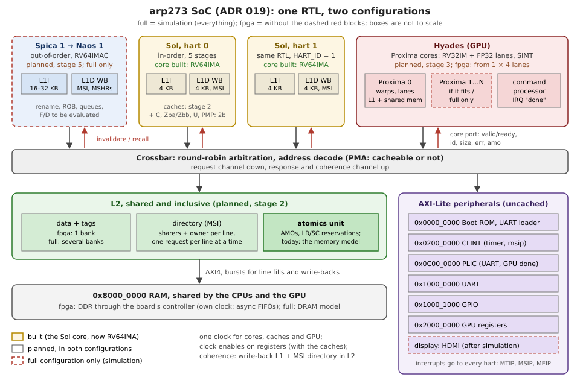

# ADR 019: A heterogeneous SoC: Naos/Spica, Sol and Hyades on one coherent L2

## Context

Stage 1 and Sol 2 were finished ahead of the plan. The author decided to build the whole system at
once instead of one block after another: a full configuration with a large out-of-order core, small
in-order cores and the GPU (simulated), and a reduced configuration of the same RTL for the FPGA. The
choices below come from the author's answers to a survey of every open question of the platform
(2026-11-26). The previous plan had a vector unit (RVV) as its stage 3 and no out-of-order core; the
time budget (about 1425 hours to September 2027) does not hold all of them.

## Options

| Question | Options considered | Chosen |
|---|---|---|
| Vector unit (RVV) | keep as stage 3; minimal RVV in Sol; reserve; drop | **reserve** (the GPU carries the data-parallel part) |
| Operating system | bare metal; Linux in reserve; Linux required | **bare metal, Linux in reserve** (needs S-mode, Sv39, TLB) |
| Order after the platform | GPU then big core; big core then GPU; alternate | **GPU, then the big core**: the GPU demos are never cut, the big core can shrink |
| L1D write policy and coherence | write-through L1 + directory; write-back L1 + MSI; software | **write-back L1 + MSI from the start** |
| Core port | own valid/ready extended; OBI; AXI4 from the core | **own, extended** with `id`, `size`, `err`, several requests in flight |
| SoC edge | AXI4 + AXI-Lite; TileLink; Wishbone | **AXI4** to the DRAM controller, **AXI-Lite** to peripherals |
| Atomics (A) | in L1; in L2 | **in L2** ("far" AMOs): L2 recalls a line held in M, then does the read-modify-write |
| First big core | Spica first, then wider; 4-wide at once; 3-wide only | **Spica 1 (2-wide), then wider parameters (Naos 1)** |
| Full configuration | 1 Naos + 2 Sol; 2 Naos + 4 Sol; 2 Naos + 2 Spica + 4 Sol | **1 Naos + 2 Sol** (counts are parameters) |
| CPU ISA beyond RV64IMA | Zicbom/Zicboz, Zba + Zbb, C, F/D | **Zicbom/Zicboz, Zba + Zbb, C**; **F/D only for Naos, to be evaluated**; Sol without F/D (ADR 015) |
| Privilege modes | M; M + U; M + U + PMP | **M + U + PMP** |
| GPU size on the FPGA | 1 × 4 lanes; 2 × 4; 1 × 8 | **from 1 Proxima × 4 lanes up** to the largest that fits; 1 × 8 against 2 × 4 chosen by measured throughput per LUT and energy |
| Floating point in the GPU | integer + fixed point; FP32 per lane; FP16 or shared FPU | **IEEE 754 FP32 per lane** (an RV32F subset) |
| Graphics output | frames over UART; HDMI; simulation only | **simulation first, then HDMI** |
| Formal verification | none; bus protocols; MSI; riscv-formal for Sol | **all three, from the simplest**: bus protocol properties, MSI on a small configuration, riscv-formal for Sol |
| Loading and debug on the board | UART loader; RISC-V debug module over JTAG | **UART loader** (+ ILA); the debug module is in reserve |
| Clock gating (about 40 % of Sol 2's energy is flip-flop clocking, ADR 016) | with the caches; as Sol 3; in stage 5a | **with the caches**, in stage 2 |
| CI | fast SoC on push, full nightly; everything on push; as now | **as now**; the SoC runs locally |

## Decision

### Configurations

One RTL, two configurations of the SoC (a file like `rtl/sol/configs.json`):

| | `full` (simulation) | `fpga` |
|---|---|---|
| Big cores | 1 Naos (first Spica 1) | none |
| Small cores | 2 Sol | 2 Sol |
| GPU (Hyades) | Proxima cores × lanes as parameters | from 1 × 4 up |
| L2 | shared, banked | shared, one bank |
| Memory | DRAM model | DDR through the board's controller |

### Blocks

- **CPU ISA:** RV64IMAC + Zicsr, Zifencei, Zicbom, Zicboz, Zba, Zbb; modes M and U, PMP. The same
  ISA on Sol and Naos, so that a task can move between them. F/D for Naos is evaluated separately.
- **Sol:** A (AMOs sent to L2, LR/SC with a reservation), `mhartid` as a parameter, interrupts
  (MTIP, MSIP, MEIP) taken in WB, WFI sleep, the C extension (fetch of 16-bit-aligned instructions),
  U-mode and PMP, the extended port, clock enables on its registers.
- **Spica / Naos** (`rtl/spica-naos`): 2-wide first; rename, ROB, issue queues, load and store
  queues, non-blocking L1D with MSHRs, in-order commit (the Spike comparison works unchanged).
- **L1I:** read-only, invalidated by FENCE.I and by the directory.
- **L1D:** write-back, MSI (states I, S, M plus transient states), one request in flight on Sol,
  MSHRs on Naos.
- **L2:** shared, inclusive, directory with a sharer vector and an owner per line; it serializes
  requests per line, sends invalidations and recalls, executes AMOs; write-back to DRAM over AXI4.
- **GPU:** Hyades is a master on L2, like a core; its L1s take part in the same protocol, or (if that
  proves too costly) are write-through with invalidation from the directory. That choice is measured
  and recorded when the GPU is designed (stage 3).
- **Interconnect:** crossbar from the core ports to L2, round-robin arbitration; a return channel for
  invalidations and recalls; an uncached path to AXI-Lite peripherals; a table of regions that are
  cacheable (PMA).
- **Interrupts and peripherals:** CLINT (`mtime`, `mtimecmp` and `msip` per hart), a simple PLIC
  (sources: UART, GPU done), UART, GPIO, boot ROM with a UART loader, GPU registers, HDMI output later.
- **Clocking:** one clock for cores, caches and GPU; clock-domain crossings only at the DRAM
  controller and the display, through asynchronous FIFOs with tests.

### Address map

| Address | Device |
|---|---|
| 0x0000_0000 | Boot ROM |
| 0x0200_0000 | CLINT |
| 0x0C00_0000 | PLIC (new; the address used by Spike and QEMU) |
| 0x1000_0000 | UART |
| 0x1000_1000 | GPIO |
| 0x2000_0000 | GPU registers |
| 0x8000_0000 | RAM, shared by CPUs and GPU |

### Order

| Stage | Period | Result |
|---|---|---|
| 2. Platform | 27.11.2026 – 16.01.2027 | A, multi-hart, CLINT, interrupts; L1 + L2 with MSI; interconnect, UART, PLIC; clock enables; 2 Sol on the FPGA with CoreMark |
| 2b. ISA and checks | in the semester, next to stage 3 | C, Zba/Zbb, Zicbom/Zicboz, U + PMP; RISCOF; litmus tests; formal (bus, MSI, riscv-formal) |
| 3. Hyades | 17.01 – 20.05.2027 | GPU specification, Proxima with FP32 lanes, Hyades on L2; checkpoint 20.05 |
| 4. Integration and demos | 21.05 – mid-June | driver, runtime, MNIST, 3D cube (simulation, then HDMI) |
| 5. Spica 1 → Naos 1 | mid-June – mid-August | 2-wide OoO in the `full` configuration, heterogeneous scheduler; wider parameters if time is left |
| 6. Report | end of August | report, video, README, applications |

**Never cut:** module tests, the Spike comparison, the CI regression, CoreMark on the FPGA, MNIST on
the GPU, the 3D cube, the heterogeneous scheduler (so Spica 1 itself is never cut; only its widening
to Naos is).

## Consequences

- **The budget is exceeded.** Estimate (not a measurement): platform about 550 hours with write-back
  MSI, the new extensions, formal checks and clock gating; GPU with FP32 lanes about 330; integration
  and demos with HDMI about 240; Spica 1 about 350–450; report 120. That is about 1600–1700 hours
  against about 1475 available. **Cut first, in this order:** F/D on Naos; widening Spica to Naos;
  HDMI (frames from simulation remain); riscv-formal for Sol; the C extension (on all CPUs together,
  because they share the ISA); Zba/Zbb. Then the previous list: misaligned access, coalescing in the
  GPU, stage 5a.
- **Write-back MSI from the start** costs more design and verification than write-through with a
  directory (transient states, races between a recall and a write-back), so the MSI checks (a
  scoreboard on random traffic from several masters, litmus tests, the formal proof on 2 cores × 2
  lines) are written together with the protocol, not after it.
- **The board** is chosen by the end of December, from synthesis numbers of the `fpga` configuration;
  without it the 14–16.01 checkpoint shows the platform in simulation only.
- **CI stays as it is.** The SoC tests, formal runs and benchmarks run locally, one heavy job at a
  time.
- ADR 015 is updated: the order of the cores changes (Spica 1 in stage 5 of this plan).
- The vector unit and Linux stay in the reserve; ADR 015's `v` variant letter stays reserved for it.
