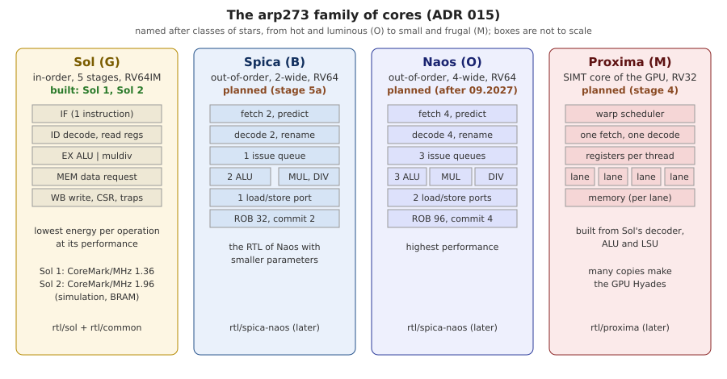

# The cores of arp273

One family of cores, named after classes of stars ([ADR 015](../adr/015-core-family.md)): from hot,
luminous and short-lived (class O) to small, frugal and numerous (class M), as the cores run from the
fastest to the most frugal. Each core has a page here: what it is, how it works, how it differs from the
others, and a diagram.



| Core | Class | Microarchitecture | ISA | Goal | State | RTL | Page |
|---|---|---|---|---|---|---|---|
| **Sol** | G | in-order, 5 stages | RV64IM, M-mode | lowest energy per operation at its performance | **built**: Sol 1, Sol 2 | `rtl/sol` | [sol/](sol/README.md) |
| **Spica** | B | out-of-order, 2-wide | RV64 | performance at lower energy | planned (stage 5a) | `rtl/spica-naos` (later) | [spica/](spica/README.md) |
| **Naos** | O | out-of-order, 4-wide | RV64 | highest performance | planned (after 09.2027) | `rtl/spica-naos` (later) | [naos/](naos/README.md) |
| **Proxima** | M | SIMT, one front end, several lanes | RV32 + GPU instructions | throughput per area and per joule | planned (stage 4) | `rtl/proxima` (later) | [proxima/](proxima/README.md) |

The GPU as a whole is **Hyades**: many Proxima cores ([proxima/](proxima/README.md)).

## Names, generations, variants

A full name is `<star> <generation>[<variant>]` (ADR 015), for example `Sol 2`, `Sol 2s`, `Sol 1-32`:

- **A generation** changes the microarchitecture and gets a page with what changed, why, and the
  measurements before and after ([sol/sol1.md](sol/sol1.md), [sol/sol2.md](sol/sol2.md)).
- **A variant** is a parameter set of the same RTL: `s` small, `v` with the vector unit, `-32` RV32.

## How the code is kept

**Generations of one core are configurations of one RTL, not copies.** Sol 1 and Sol 2 are both
`rtl/sol/core_pipe.sv`: Sol 1 is `MUL_BITS = 1`, Sol 2 is `MUL_BITS = 4`. The parameter sets are in
`rtl/sol/configs.json`, which the tests and the `Makefile` read:

```sh
make bench CONFIG=sol1          # Sol 1
make bench CONFIG=sol2          # Sol 2 (also the default)
make energy CONFIG=sol2-bp      # Sol 2 with the branch predictor (built, not enabled: ADR 018)
```

Every test of the core runs in every configuration, so a fix reaches all generations at once. A
generation is also frozen in a release tag (Sol 1: `v0.1.0`), which gives its exact code and tests.

A new folder is made only when the microarchitecture cannot be expressed by parameters: an
out-of-order core (Spica and Naos share one) or the SIMT core.

```
rtl/
  pkg/          the package: XLEN, opcodes, types
  common/       units shared by the cores: alu, branch_unit, csr, decoder, imm_gen, lsu, muldiv,
                perf_counters, regfile (descriptions: docs/modules/)
  sol/          Sol: core_pipe.sv (the pipeline), bpred.sv (branch predictor), configs.json
  ref/          the single-cycle reference core, core.sv (compared with Sol in simulation)
  spica-naos/   (later) the out-of-order core
  proxima/      (later) the SIMT core
```

## Comparing the cores

Every core is measured with the same programs and the same tools, and its results are kept in
`docs/results/<core>.json`:

- `make bench`: 29 self-checking benchmarks (CoreMark, riscv-tests, Embench-IoT; the floating-point
  ones in soft-float) → cycles, CoreMark/MHz;
- `make energy`: energy from the switching activity of the gate netlist ([ADR 016](../adr/016-energy-estimate.md));
- `make area`: LUT6, flip-flops, transistors, logic delay on xc7.

A change is accepted when it lowers energy × time per CoreMark iteration ([ADR 017](../adr/017-multiplier-bits-per-cycle.md)).
