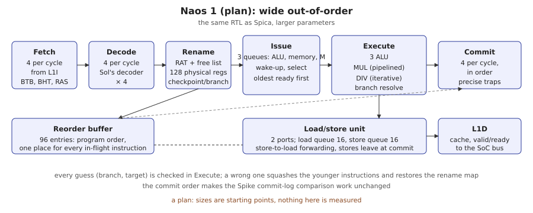

# Naos: the wide out-of-order core (plan)

Naos (class O, after ζ Puppis, a blue supergiant) is the performance core of the family
([ADR 015](../../adr/015-core-family.md)): out of order, four instructions per cycle, RV64. It is **not
built**: Spica 1 comes first (stage 5, mid-June – mid-August 2027); Naos 1 is the same RTL widened if time is left, otherwise after September 2027 ([ADR 019](../../adr/019-soc-architecture.md)). Naos and [Spica](../spica/README.md) are one RTL (`rtl/spica-naos`)
with different parameters. This page is the starting point for that design; nothing in it is measured.

## How it would work

1. **Fetch** four instructions per cycle from an L1 instruction cache, with a branch predictor (BHT, BTB,
   return stack) that picks the next fetch address.
2. **Decode** four instructions with four copies of Sol's decoder (`rtl/common/decoder.sv`).
3. **Rename** maps the 31 architectural registers to physical registers (a register alias table and a
   free list), so that instructions that only reuse a register name no longer wait for each other. Each
   branch takes a checkpoint of the map, so a misprediction restores it in one cycle.
4. **Issue queues** hold renamed instructions until their operands are ready; each cycle the oldest ready
   ones go to the execution units.
5. **Execute:** three ALUs (`rtl/common/alu.sv`), a pipelined multiplier, an iterative divider, branch
   resolution; results wake up waiting instructions.
6. **Load/store unit:** loads may run ahead of older stores whose addresses differ; a load that hits an
   older store gets its data forwarded; stores leave for memory only at commit.
7. **Commit** up to four instructions per cycle in program order from the reorder buffer: exceptions
   stay precise, and the commit log stays comparable with Spike as it is for Sol.

## Starting parameters (Naos 1)

| | Naos 1 | Spica 1 | Sol 2, for comparison |
|---|---|---|---|
| Fetch, decode, commit per cycle | 4 | 2 | 1 |
| Pipeline depth | about 10 | about 8 | 5 |
| Reorder buffer | 96 | 32 | — |
| Physical registers | 128 | 64 | 32 architectural |
| Issue queues | 3 (ALU, memory, M) | 1 shared | — |
| Execution units | 3 ALU, pipelined MUL, DIV, 2 memory ports | 2 ALU, MUL, DIV, 1 memory port | ALU, iterative MUL/DIV |
| Load / store queue | 16 / 16 | 8 / 8 | — |
| Branch prediction | BHT, BTB, return stack | the same, smaller | none (built, not adopted) |
| Caches | L1I, L1D | L1I, L1D | none yet (stage 2) |
| ISA | RV64IM + Zicsr (+ F/D for an operating system) | the same | RV64IM + Zicsr |

The sizes follow the configurations of comparable open designs (BOOM's small to large configurations);
they are to be measured before they are fixed.

## What Sol 2 taught for this design

- **The predictor must stay off the critical path.** In Sol 2 the target check after the EX adder
  lengthened the logic path by about 700 ps ([ADR 018](../../adr/018-branch-prediction.md)). Here,
  branch and JAL targets should be checked at decode, where `pc + imm` is known.
- **Tables clocked every cycle cost energy.** The 23 % more flip-flops of Sol 2's predictor cost 13 %
  more energy per CoreMark iteration. Large structures (reorder buffer, queues, physical registers) need
  memories or clock gating, not plain flip-flops.
- **Measure the same way:** the 29 benchmarks, the energy estimate, area and delay, on one curve with Sol.

## What it needs first

Caches and a bus (stage 2), the A extension and cache coherence before several cores share memory, and
the interfaces noted before stage 2 (several outstanding memory requests, a predictor interface in fetch).
