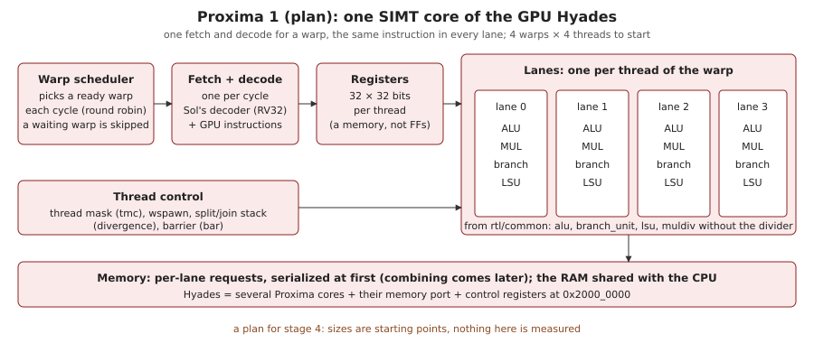

# Proxima: the SIMT core of the GPU (plan)

Proxima (class M, after Proxima Centauri, a red dwarf) is the smallest core of the family
([ADR 015](../../adr/015-core-family.md)): the core of the GPU **Hyades**, of which there are many copies.
It is **not built**: it is designed in stage 3 together with the GPU specification ([ADR 019](../../adr/019-soc-architecture.md)), with IEEE 754 FP32 in every lane. In the style of
Vortex (a RISC-V core per thread group with thread-control instructions); inspired by it, no code reused.

## How it would work

- **SIMT:** threads are grouped in warps. One fetch and one decode serve a whole warp, and every lane
  executes the same instruction for its own thread, on its own registers.
- **Warp scheduler:** each cycle picks a warp that is ready (round robin); a warp that waits for memory
  is skipped, so several warps hide each other's latency instead of a branch predictor or caches doing it.
- **Divergence:** when the threads of a warp take different sides of a branch, `split` pushes the
  current thread mask on a stack and runs one side with part of the threads; `join` brings them
  together again.
- **Thread control instructions:** `tmc` (set the thread mask), `wspawn` (start warps), `split`/`join`,
  `bar` (barrier between warps).
- **Memory:** every lane has its LSU; at first their requests go out one after another, and combining
  neighbouring requests comes later (it is on the list of things cut first).

## Starting parameters (Proxima 1)

| | Proxima 1 | For comparison: Sol 2 |
|---|---|---|
| ISA | RV32IM (no division in hardware) + the GPU instructions | RV64IM + Zicsr |
| Warps × threads per warp | 4 × 4 | 1 thread |
| Registers | 32 × 32 bits per thread: 16 threads × 128 bytes = 2 KiB per core, in a memory | 31 × 64 bits in flip-flops |
| Per lane | ALU, branch unit, LSU, multiplier (`muldiv` without the divider) | — |
| Exceptions, CSRs | none, except reading the thread and warp number | M-mode CSRs, precise exceptions |
| Branch prediction | none: other warps run while one waits | none |

## Built from Sol

The decoder, ALU, branch unit, LSU and multiplier come from `rtl/common/`, already verified and
mutation-tested. What is new is the SIMT part: the warp scheduler, the registers per thread, the
thread masks and the divergence stack, and the memory path of several lanes.

## What Sol 2 taught for this design

- **Area and clocked flip-flops multiply by the number of copies.** The registers per thread go into a
  memory, not flip-flops (in Sol the register file is the largest block when it is built from
  flip-flops).
- **A multiplier per lane is affordable at four bits per cycle.** Sol 2's multiplier costs about 800
  LUT6 more than Sol 1's at XLEN = 64 (ADR 017); at XLEN = 32 and without the divider, far less.
- **The same measurements:** throughput per area and per joule with the same energy estimate (ADR 016),
  on kernels of the demos (integer matrix multiplication for MNIST).
