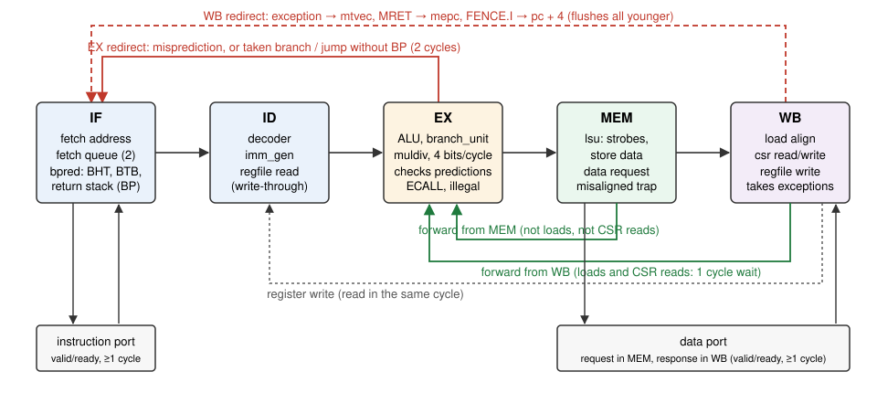

# Sol: the in-order core

Sol (class G, like the Sun) is the in-order core of the family ([ADR 015](../../adr/015-core-family.md)):
a five-stage pipeline that implements RV64IM in machine mode. It aims at the lowest energy per
operation at its level of performance, and its units are reused by the GPU core Proxima.

| | |
|---|---|
| ISA | `rv64im_zicsr_zifencei`, M-mode; RV32IM with `XLEN = 32` ([spec](../../spec.md)) |
| Pipeline | IF (2-entry fetch queue), ID, EX, MEM, WB; forwarding from MEM and WB, one cycle for load-use, branches decided in EX (two cycles when taken) |
| Exceptions | precise, taken in WB ([ADR 014](../../adr/014-csr-and-exceptions.md)) |
| Memory ports | instruction and data, valid/ready, any latency, one outstanding request each ([ADR 013](../../adr/013-pipeline-and-memory-interface.md)) |
| Multiplier/divider | one iterative unit; `MUL_BITS` multiplier bits per cycle, division one bit per cycle ([ADR 017](../../adr/017-multiplier-bits-per-cycle.md)) |
| Branch prediction | optional (`BP`), built and measured, not enabled ([ADR 018](../../adr/018-branch-prediction.md)) |
| RTL | `rtl/sol/core_pipe.sv`, `rtl/sol/bpred.sv`, the units of `rtl/common/` |
| Module page | [modules/core_pipe.md](../../modules/core_pipe.md) (ports, stages, tests) |

## Units

| Stage | Units (`rtl/common/`, described in `docs/modules/`) |
|---|---|
| IF | — (optional `bpred` from `rtl/sol/`) |
| ID | [decoder](../../modules/decoder.md), [imm_gen](../../modules/imm_gen.md), [regfile](../../modules/regfile.md) (read) |
| EX | [alu](../../modules/alu.md), [branch_unit](../../modules/branch_unit.md), [muldiv](../../modules/muldiv.md) |
| MEM | [lsu](../../modules/lsu.md) (store side) |
| WB | [lsu](../../modules/lsu.md) (load side), [csr](../../modules/csr.md), [regfile](../../modules/regfile.md) (write) |
| all | [perf_counters](../../modules/perf_counters.md) |

How the units connect and what they cost: [modules/overview.md](../../modules/overview.md).

## Generations and configurations

| Name | Configuration (`rtl/sol/configs.json`) | What it is | Page |
|---|---|---|---|
| **Sol 1** | `sol1`: `MUL_BITS = 1`, `BP = 0` | the first pipeline, release `v0.1.0` | [sol1.md](sol1.md) |
| **Sol 2** | `sol2`: `MUL_BITS = 4`, `BP = 0` (the defaults) | four multiplier bits per cycle | [sol2.md](sol2.md) |
| Sol 2 with prediction | `sol2-bp`: `MUL_BITS = 4`, `BP = 1` | measured, not adopted | [sol2.md](sol2.md#branch-prediction-measured-not-adopted) |

`make bench CONFIG=sol1`, `make energy CONFIG=sol2`, and so on. Every test of the core runs in all
three configurations.

| | Sol 1 | Sol 2 |
|---|---|---|
| CoreMark/MHz | 1.360 | 1.961 |
| Geometric mean of speedups, 29 benchmarks | 1.000 | 1.215 |
| Energy per CoreMark iteration (ADR 016 units) | 1.127 × 10¹⁰ | 0.941 × 10¹⁰ |
| Energy × time per iteration (relative) | 4.69 | 2.96 |
| Core: LUT6 / flip-flops | 5802 / 3741 | 6572 / 3740 |
| Logic delay of the core, xc7 (not Fmax) | 5650 ps | 6155 ps |

Measured 2026-11-26 (simulation on a one-cycle BRAM; Yosys 0.66; release builds; one synthesis per
configuration, the run of ADR 017). Not official CoreMark scores; no Fmax before place-and-route.

## Variants

- `-32`: RV32IM, `XLEN = 32` (built and tested in every unit test).
- `s` (small): planned; would leave out the stall and flush counters and the predictor.
- `v`: with the vector unit (stage 3).
