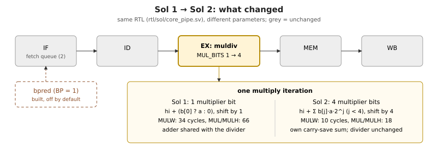

# Sol 2

The second generation of Sol: Sol 1 with a multiplier that takes four bits per cycle. It is the
configuration `sol2` of `rtl/sol/core_pipe.sv` (`MUL_BITS = 4`, `BP = 0`), the default. Design and plan:
[design/sol2.md](../../design/sol2.md), [design/sol2-plan.md](../../design/sol2-plan.md).

## What changed

| | Sol 1 | Sol 2 |
|---|---|---|
| Multiply iteration | 1 multiplier bit, adder shared with the divider | 4 multiplier bits in one carry-save sum ([ADR 017](../../adr/017-multiplier-bits-per-cycle.md)) |
| `MULW`, short `MUL` | 34 cycles | 10 cycles |
| `MULH*`, full `MUL` | 66 cycles | 18 cycles |
| Division | unchanged | unchanged |
| Everything else | | unchanged |

Why four and not eight: eight bits per cycle needs fewer cycles (CoreMark/MHz 2.117 against 1.961), but
its sum of eight partial products becomes the longest path of the core (9339 ps against 6155 ps), so one
CoreMark iteration takes longer than on Sol 1. The choice is made on energy × time.

## Measurements

2026-11-26, release build, simulation on a one-cycle BRAM, RTL `3c7be96` plus Sol 2 (results:
`docs/results/sol2.json`, `docs/results/sol2-energy.json`, `docs/results/mul-bits.json`).

| | Sol 1 | Sol 2 | Change |
|---|---|---|---|
| CoreMark/MHz | 1.360 | 1.961 | ×1.44 |
| Geometric mean of speedups, 29 benchmarks | 1.000 | 1.215 | from ×1.00 (no multiplications) to ×2.5 (`edn`) |
| Cycles per CoreMark iteration | 736 207 | 510 631 | −31 % |
| Energy per iteration | 1.127 × 10¹⁰ | 0.941 × 10¹⁰ | −16.5 % |
| Energy × time per iteration (relative) | 4.69 | 2.96 | −37 % |
| LUT6 / flip-flops | 5802 / 3741 | 6572 / 3740 | +13 % LUT6 |
| Transistors (CMOS estimate) | 127 320 | 146 394 | +15 % |
| Logic delay, xc7 | 5650 ps | 6155 ps | +9 % |

Shorter multiplications save energy as well as time: the 3741 flip-flops are clocked for 226 thousand
fewer cycles per iteration.

## Branch prediction: measured, not adopted

The plan of Sol 2 also had a branch predictor (BHT 64, BTB 16, return stack 8; [ADR 018](../../adr/018-branch-prediction.md)).
It was built and verified (configuration `sol2-bp`), and it reaches 2.175 CoreMark/MHz. It is not
enabled: its tables add 23 % flip-flops, clocked every cycle, and its target check lengthens the logic
path by about 700 ps, so one iteration takes the same time and 13 % more energy. ADR 018 lists what
would make it pay off; a later generation may take it up.

## What limits it now

By the trace model of the design (an estimate from the commit trace, not a measurement), CoreMark's
remaining cycles above one per instruction are: multiplications about 0.85 million (94 thousand `MULW`,
nine extra cycles each), taken branches and jumps about 0.75 million (two cycles each), load-use about
0.22 million. The clock of the flip-flops is still about 40 % of the energy (measured), which clock
gating would attack.
