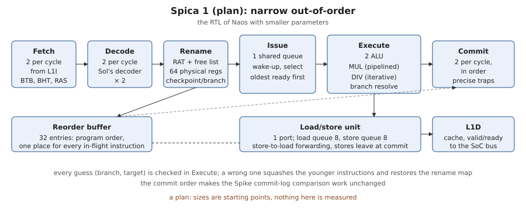

# Spica: the narrow out-of-order core (plan)

Spica (class B, after α Virginis) is the efficient out-of-order core of the family
([ADR 015](../../adr/015-core-family.md)): two instructions per cycle, RV64. It is **not built**: planned for
stage 5 (mid-June – mid-August 2027), after the GPU, in the `full` SoC configuration ([ADR 019](../../adr/019-soc-architecture.md)). It is the RTL of [Naos](../naos/README.md)
(`rtl/spica-naos`) with smaller parameters, so it is built and verified first, and Naos follows by
raising the parameters.

## How it differs from Naos and from Sol

| | Sol 2 | **Spica 1** | Naos 1 |
|---|---|---|---|
| Order | in order | out of order | out of order |
| Instructions per cycle | 1 | 2 | 4 |
| Reorder buffer | — | 32 | 96 |
| Physical registers | 32 architectural | 64 | 128 |
| Issue queues | — | 1 shared | 3 |
| Execution units | ALU, iterative MUL/DIV | 2 ALU, MUL, DIV | 3 ALU, MUL, DIV |
| Memory ports | 1 | 1 | 2 |
| Load / store queue | — | 8 / 8 | 16 / 16 |

How the stages work is on the [Naos page](../naos/README.md); Spica has the same stages with fewer
lanes and smaller tables.

## Why it exists

Between Sol and Naos on the energy–performance curve (ADR 015): faster than Sol where instructions can
overlap (independent loads, branches around multiplications), with far fewer structures than Naos. It
answers whether a small out-of-order core beats Sol on energy × time, measured with the same 29
benchmarks and the same energy estimate. Sol 2's predictor already showed how such a core can lose:
more cycles saved than energy and logic delay allow ([ADR 018](../../adr/018-branch-prediction.md)).

## Order of work

1. Interfaces for the caches and the bus that allow more than one outstanding request (before stage 2
   designs them).
2. Spica 1 with the parameters above, verified like Sol: unit tests, the Spike commit-log comparison
   (commit stays in order), riscv-tests, random programs, mutation testing.
3. Measured against Sol 2; then Naos 1 by parameters.
