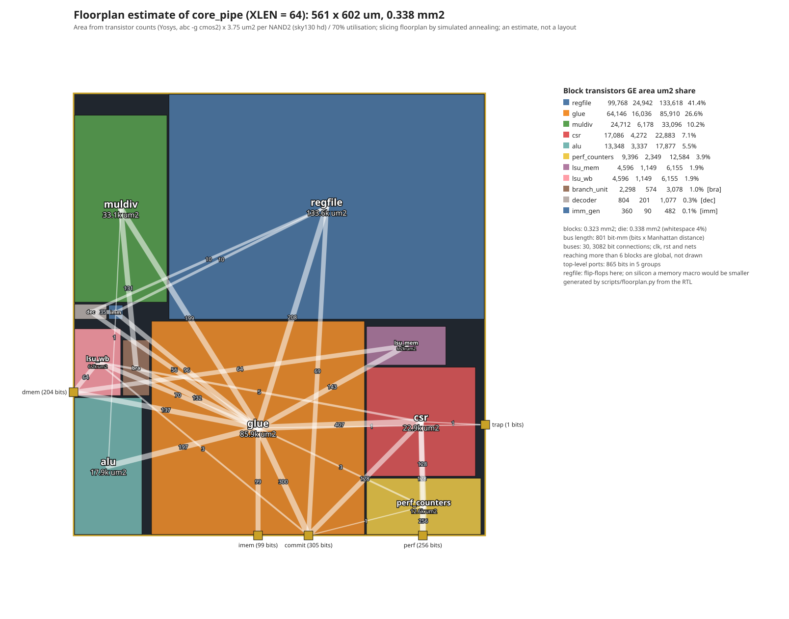
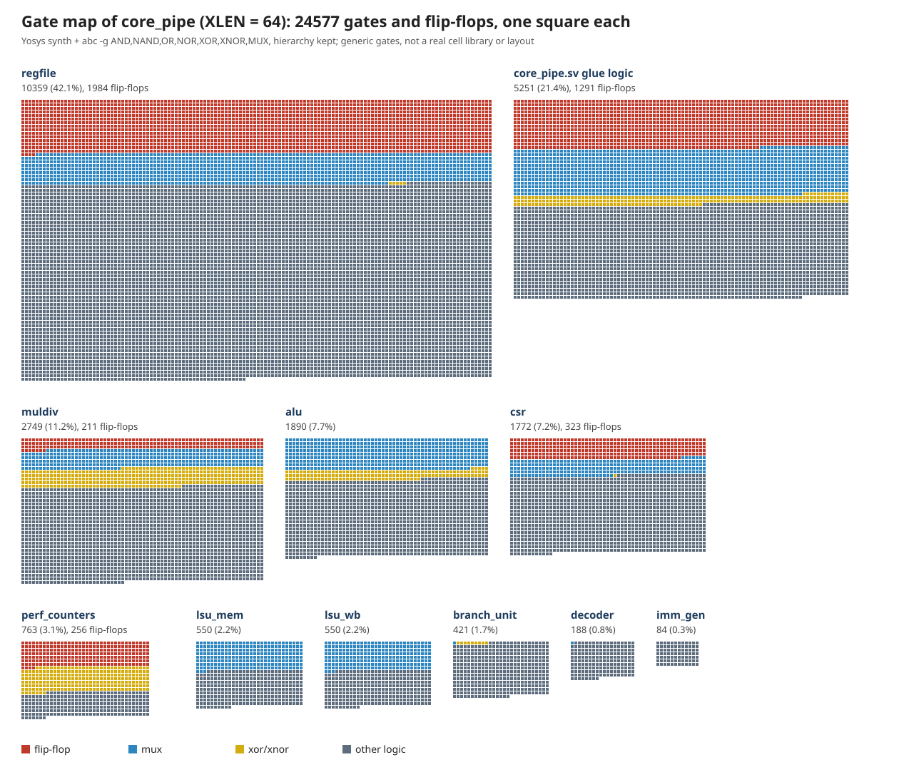
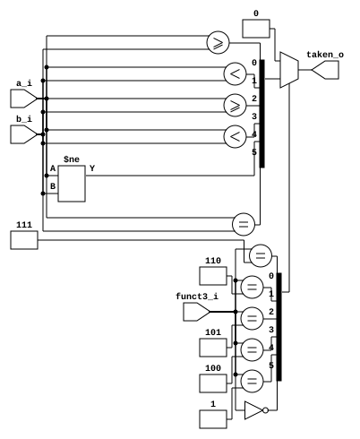

# Diagrams generated from the RTL

These pictures are drawn by scripts from the current RTL, not by hand: `make docs-img` regenerates them into
[`img/generated/`](img/generated/). The files are deterministic (fixed seeds, no dates), so they only change when
the RTL changes. Only simple, readable diagrams are kept here; the dense ones (block diagrams of the cores,
gate-level schematics, netlist graphs) are generated locally by `make schematics-all`. Hand-drawn diagrams that
explain each module are in [`img/`](img/) and linked from the [module documents](modules/overview.md).

## Pipelined core: floorplan estimate

How the pipelined core ([ADR 013](adr/013-pipeline-and-memory-interface.md)) could look on a die: block areas
from transistor counts, placed by slicing floorplanning (Wong-Liu simulated annealing), with the buses between
blocks (width in bits) and the port groups on the edges. The areas use two stated assumptions (a NAND2 of
3.75 um^2 as in sky130 high-density cells, 70 % utilisation): an order-of-magnitude estimate, not a layout.

## Pipelined core: gate map

Every gate and flip-flop of the pipelined core is one square, grouped by module, all at the same scale: where
the area goes. The register file is the largest block; the logic of `core_pipe.sv` itself (pipeline registers,
forwarding, fetch queue) is the second.

## Branch unit: word-level cells

`branch_unit.sv` after `proc; opt`: the comparators and the selection by `funct3` that decide a branch.

