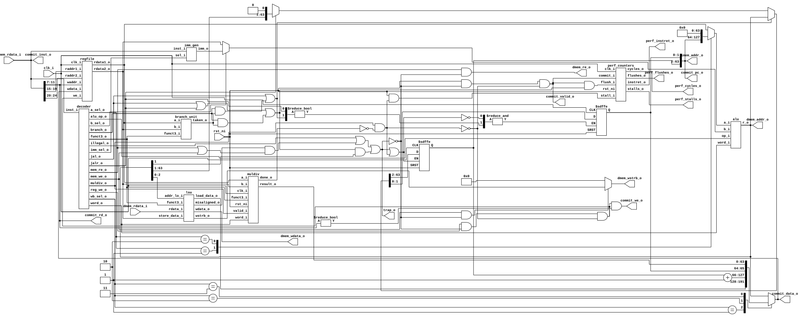
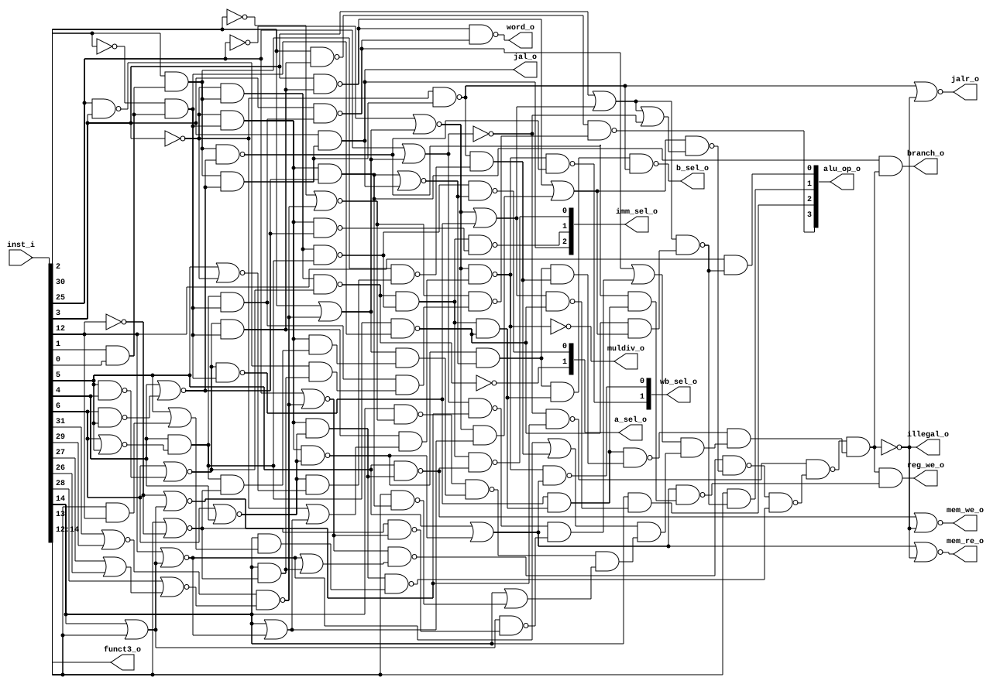
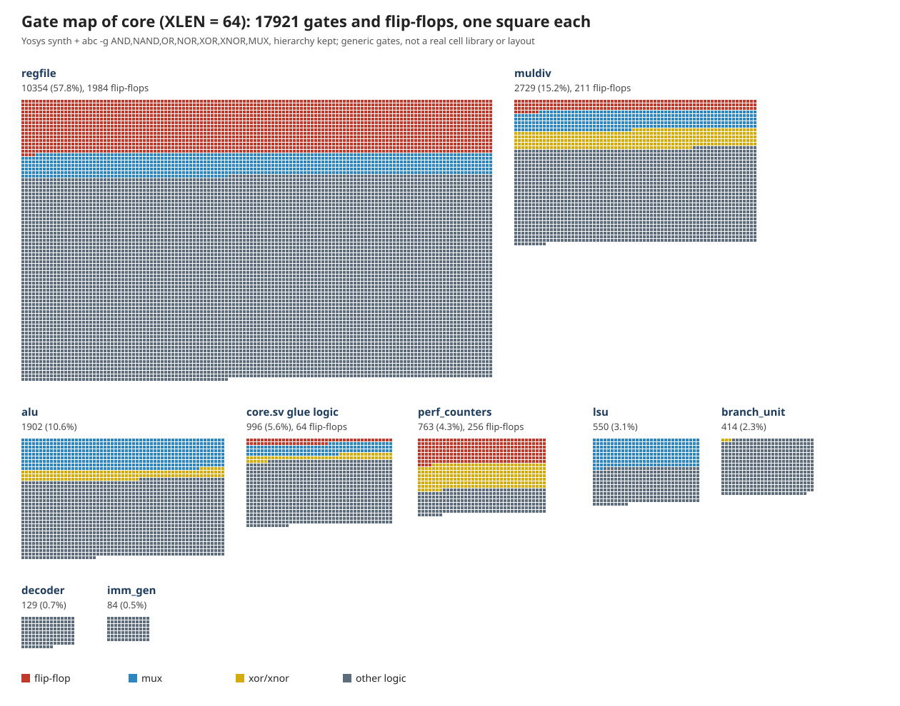
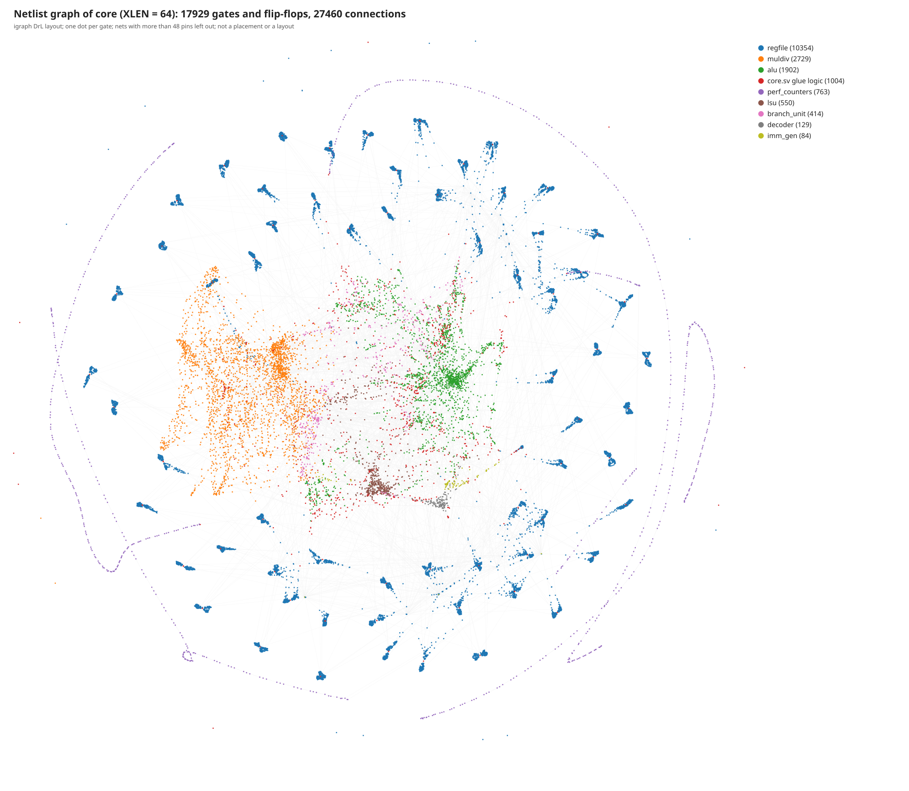
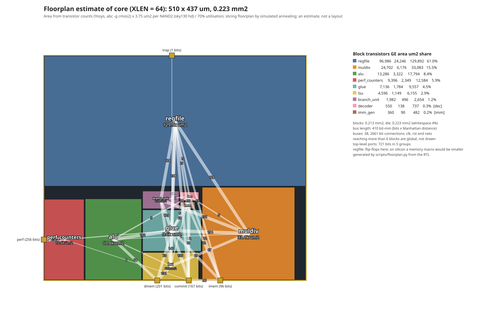

# Diagrams generated from the RTL

Every picture on this page is drawn by a script from the current RTL, not by hand: `make docs-img` regenerates
all of them into [`img/generated/`](img/generated/). The files are deterministic (fixed seeds, no dates), so
they only change when the RTL changes. Hand-drawn diagrams that explain the intent of each module are in
[`img/`](img/) and linked from the [module documents](modules/overview.md).

The scripts and all their options: `scripts/schematic.py` (`make schematics`, `make schematics-all`) and
`scripts/floorplan.py` (`make floorplan`); see [overview.md](modules/overview.md#area) for how to read the numbers.

## Core: block diagram

The single-cycle core as Yosys elaborates `core.sv`: every sub-module is a box with its ports, the lines are the
wires of `core.sv`, the small cells between the boxes are the glue logic (muxes, next PC, commit log).

## Decoder: gates

`decoder.sv` synthesized to simple gates (AND, OR, NAND, NOR, XOR, XNOR, MUX, NOT): 129 gates.

## Branch unit: word-level cells

`branch_unit.sv` after `proc; opt`: comparators and the selection by `funct3`.

## Core: gate map

Every gate and flip-flop of the core is one square, grouped by module, all at the same scale: where the area goes.

## Core: netlist graph

The whole gate-level netlist of the core (about 18000 gates) as a graph laid out by igraph DrL: every gate is a dot,
coloured by module. The 31 registers of the register file show up as separate clusters around the edge, the
counters as long carry chains.

## Core: floorplan estimate

How the core could look on a die: block areas from transistor counts, placed by slicing floorplanning
(Wong-Liu simulated annealing), with the buses between blocks and the port groups on the edges. The areas use two
stated assumptions (a NAND2 of 3.75 um^2 as in sky130 high-density cells, 70 % utilisation): an order-of-magnitude
estimate, not a layout.

