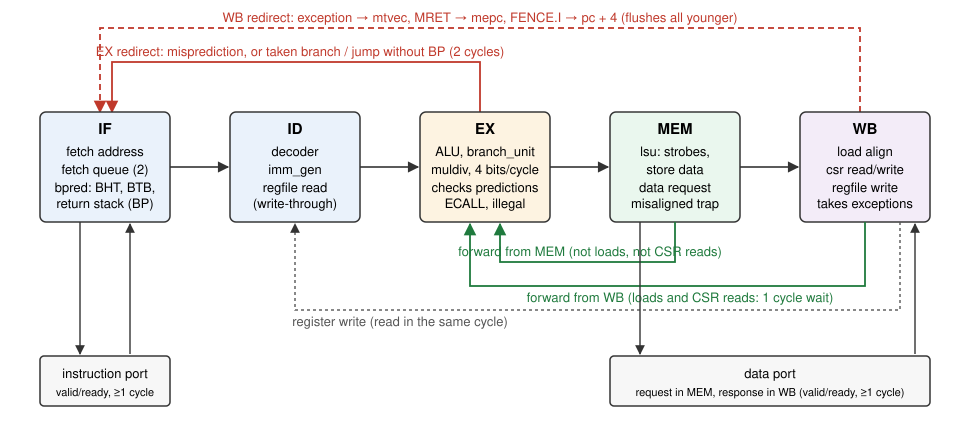

# Pipelined core (`rtl/core/core_pipe.sv`)

A five-stage pipelined RV64IM core (RV32IM for XLEN = 32): IF, ID, EX, MEM, WB. Design decisions,
measurements and verification: [ADR 013](../adr/013-pipeline-and-memory-interface.md). It is built from
the same units as the single-cycle reference core ([core.md](core.md)).

## Ports

| Port | Direction | Width | Description |
|---|---|---|---|
| `clk_i`, `rst_ni` | input | 1 | Clock, synchronous reset (active low) |
| `imem_req_valid_o`, `imem_req_ready_i`, `imem_req_addr_o` | out, in, out | 1, 1, `XLEN` | Instruction request |
| `imem_rsp_valid_i`, `imem_rsp_data_i` | input | 1, 32 | Instruction response |
| `dmem_req_valid_o`, `dmem_req_ready_i` | out, in | 1 | Data request handshake |
| `dmem_req_addr_o`, `dmem_req_we_o`, `dmem_req_wstrb_o`, `dmem_req_wdata_o` | output | `XLEN`, 1, `XLEN/8`, `XLEN` | Aligned address, write enable, byte strobes, data in its lane |
| `dmem_rsp_valid_i`, `dmem_rsp_data_i` | input | 1, `XLEN` | Data response (a store gets one too) |
| `trap_o` | output | 1 | An exception is taken in this cycle; `commit_pc_o` shows the instruction (ADR 014) |
| `commit_valid_o`, `commit_pc_o`, `commit_inst_o`, `commit_we_o`, `commit_rd_o`, `commit_data_o` | output | | Commit trace from WB, as in the single-cycle core |
| `commit_mem_re_o`, `commit_mem_we_o`, `commit_mem_addr_o`, `commit_mem_wdata_o`, `commit_mem_wstrb_o` | output | | The memory access of the committed instruction, for the commit log |
| `perf_cycles_o`, `perf_instret_o`, `perf_stalls_o`, `perf_flushes_o` | output | 64 | Cycles, retired instructions, cycles with a valid instruction held in ID, taken branches and jumps |

Parameters: `RESET_PC` (default `0x8000_0000`); `DEBUG` (default 1). `DEBUG = 0` is the release build: no commit trace (the `commit_*` outputs read 0) and no stall and flush counters; the behaviour on the memory ports is the same (`make release-check`, ADR 013).

## Memory protocol (ADR 013)

- A request transfers when `req_valid` and `req_ready` are 1 in the same cycle. A request that was not
  accepted may change or be withdrawn.
- One response per accepted request, at least one cycle later, in order; the core always takes it.
- At most one outstanding request per port; a new one may be accepted in the cycle the previous
  response arrives. A synchronous BRAM (always ready, answer in the next cycle) gives one access per cycle.

## Stages

| Stage | Does | Holds when |
|---|---|---|
| IF | issues fetch requests; responses go into a 2-entry queue | the queue would overflow, or a response is outstanding |
| ID | the queue head: decode, register read (write-through from WB) | EX cannot take it |
| EX | forwarding, ALU, branch decision and jump targets, multiplier/divider; ECALL, EBREAK, illegal and misaligned-jump exceptions | an operand is a load or CSR read still in MEM, or a load in WB without its response; the multiplier/divider is busy; MEM cannot take it |
| MEM | sends the data request (aligned, strobes from `lsu`) | WB cannot take it, or the request is not accepted |
| WB | waits for the response of a load or store, aligns the load, reads and writes CSRs, writes the register, commits; takes exceptions, MRET and FENCE.I | the response has not arrived |

- **Forwarding** into EX from MEM (ALU, link or M results, not loads) and from WB (including load data),
  never from an instruction that writes x0; MEM has priority (the younger value).
- **Load-use:** one cycle, the consumer waits in EX.
- **Taken branches and jumps** are decided in EX: the ID instruction and the fetch queue are flushed, a
  response on the way is dropped, and the target is fetched in the same cycle when the port allows:
  two cycles per taken branch.
- **Exceptions** (illegal instruction, ECALL, EBREAK, misaligned load, store or jump target, illegal CSR
  access) travel to WB and are taken there in program order: `mepc`, `mcause`, `mtval` are written, every
  younger instruction is dropped, fetch restarts at `mtvec` one cycle later. MRET (to `mepc`) and FENCE.I
  (to `pc + 4`) commit and redirect the same way. CSRs: [csr.md](csr.md), [ADR 014](../adr/014-csr-and-exceptions.md).

## Testing

- `tb/unit/test_core.py`: the 14 core tests also run on this core (`test_core_pipe_runner`), against a memory
  that stalls at random.
- `tb/unit/test_pipeline.py`: 12 hazard tests, each on a BRAM with exact cycle counts and on three slow
  memories with identical commit traces.
- `tb/unit/test_csr.py`: 8 tests of CSRs and exceptions (ADR 014).
- `make mutate M=core_pipe`: 52 mutants, 51 caught, 1 equivalent.
- `make riscv-tests`: `rv64ui-p` and `rv64um-p`, 66 of 66 (`ma_data` not run: misaligned access traps).
- `make regress CORE=pipe`, `make fuzz CORE=pipe`, also with `MEM_STALL=0.3`: match Spike.

## Status

`make lint` and `make struct` are clean for XLEN = 64 and 32. Area and logic delay are in
[ADR 013](../adr/013-pipeline-and-memory-interface.md) and [overview.md](overview.md); Fmax needs
place-and-route on the board.
