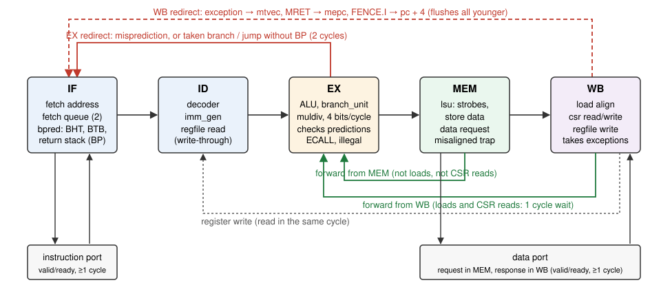

# Modules: connections and area

The contract of the core (ISA, CSRs, ports, timing) is in [spec.md](../spec.md); how it is verified, in
[verification.md](../verification.md). This page shows how the modules fit together and what they cost.

## How the modules connect

Two cores are built from the same modules in `rtl/core`:
- **`core_pipe.sv`**, the five-stage pipeline ([core_pipe.md](core_pipe.md),
  [ADR 013](../adr/013-pipeline-and-memory-interface.md), [ADR 014](../adr/014-csr-and-exceptions.md)), is the
  design;
- **`core.sv`**, the single-cycle core ([core.md](core.md)), is the reference it is compared with in
  simulation.

Where each module sits in the pipeline:

| Stage | Modules | Logic in `core_pipe.sv` itself |
|---|---|---|
| IF | — | fetch address, 2-entry fetch queue, drop of stale responses, redirect select |
| ID | `decoder`, `imm_gen`, `regfile` (read ports, write-through) | `imm + 4` for the jump-target adder, which registers are read |
| EX | `alu`, `branch_unit`, `muldiv` | forwarding muxes, operand wait (load and CSR use), jump target and target + 4, exception cause and `mtval` |
| MEM | `lsu` (instance `u_lsu_mem`: strobes, store data, misaligned check) | data request |
| WB | `lsu` (instance `u_lsu_wb`: load alignment and extension), `csr`, `regfile` (write port) | write-back select, exception entry, MRET and FENCE.I redirect |
| all | `perf_counters` | commit trace (debug build only) |

Main connections:
- **`decoder`** turns the instruction into the control fields that travel down the pipeline: ALU operation,
  operand selects, write-back select, `reg_we`, `mem_re`, `mem_we`, `branch`, `jal`, `jalr`, `muldiv`, `csr`,
  `ecall`, `ebreak`, `mret`, `fence_i`, `illegal`.
- **`imm_gen`** builds the immediate from the instruction and `imm_sel`. For an illegal or CSR instruction,
  ID passes the instruction bits instead: they become `mtval`, the CSR address and the 5-bit immediate.
- **`regfile`** is read in ID and written in WB. Write-through means a value written in WB is read in the
  same cycle (ADR 004).
- **`alu`** computes the result, the memory address and the jump target. A second adder computes
  target + 4, so that a taken branch can fetch its target in the same cycle (ADR 013).
- **`branch_unit`** compares the two forwarded operands according to `funct3`. Together with `branch`, `jal`
  and `jalr` its output decides the redirect from EX.
- **`muldiv`** holds EX until `done`. If the instruction is dropped by an exception, `abort_i` returns it
  to idle.
- **`lsu`** is used twice: in MEM for the store side, in WB for the load side, because the load data arrives
  with the response in WB.
- **`csr`** is read and written by the instruction committing in WB. It also takes the exception (`mepc`,
  `mcause`, `mtval`, `MIE`/`MPIE`) and gives the redirect targets `mtvec` and `mepc`.
- **`perf_counters`** counts cycles, retired instructions, stalls and flushes. `mcycle` and `minstret` read
  the first two.

The single-cycle core uses the same modules without pipeline registers and without `csr`. Its diagram is
[img/units-overview.svg](../img/units-overview.svg).

Diagrams of the individual modules: [decoder](../img/decoder.svg), [imm_gen](../img/imm_gen.svg),
[regfile](../img/regfile.svg), [branch_unit](../img/branch_unit.svg), [lsu](../img/lsu.svg),
[alu](../img/alu.svg), [muldiv](../img/muldiv.svg).

The diagrams in `docs/img/` are drawn by hand and explain the intent. Diagrams drawn from the current RTL
come in two kinds:
- **Committed.** A few simple ones are shown on GitHub: [diagrams.md](../diagrams.md), regenerated by
  `make docs-img`.
- **Local.** Every module at every level is drawn by `make schematics-all` into `build/schematics/<level>/`
  (Yosys netlist, rendered by netlistsvg, Graphviz or igraph). The levels are `blocks`, `rtl`, `gates`,
  `flat`, `map` and `graph`; one module and level: `make schematics M=muldiv LEVEL=blocks`.

## Area

Chart: [img/units-area.svg](../img/units-area.svg). Measured 2026-11-26, Yosys 0.66, `make area`
(`scripts/area.py --xc7`), one run for all numbers, no commit hash: an estimate. These are area figures,
not Fmax and not power.

**Generic synthesis:** `synth` and `abc -lut 6`, each module on its own, then each core flat.

| Module | LUT6 / flip-flops, XLEN = 64 | LUT6 / flip-flops, XLEN = 32 | Cells, XLEN = 64 |
|---|---|---|---|
| `regfile` | 1644 / 1984 | 839 / 992 | 7356 |
| `muldiv` | 947 / 211 | 445 / 113 | 2650 |
| `csr` | 746 / 323 | 415 / 163 | 1697 |
| `alu` | 703 / 0 | 288 / 0 | 1855 |
| `perf_counters` | 308 / 256 | 308 / 256 | 763 |
| `lsu` | 305 / 0 | 93 / 0 | 542 |
| `branch_unit` | 87 / 0 | 41 / 0 | 361 |
| `decoder` | 74 / 0 | 63 / 0 | 179 |
| `imm_gen` | 32 / 0 | 32 / 0 | 69 |
| Sum of the modules (LUT6) | 4846 | 2524 | |
| **`core_pipe`** (flat) | **5920 / 4000** | **3400 / 2296** | 24255 |
| `core_pipe`, release build (`DEBUG = 0`)¹ | 5907 / 3741 | | |
| `core`, single-cycle reference (flat) | 4565 / 2515 | 2309 / 1393 | 16585 |

¹ From a separate run (`make area RELEASE=1`), 2026-11-25 ([ADR 014](../adr/014-csr-and-exceptions.md)).

**Xilinx 7** (`synth_xilinx -family xc7 -abc9`, with the Arty A7 as a candidate board). LUTRAM counts LUTs
used as distributed RAM. The delay is the latest arrival time from `sta` with cell delays only, **without
routing and without memory access time**. It compares designs; it is not Fmax.

| Module | XLEN = 64: LUT / LUTRAM / CARRY4 / ps | XLEN = 32: LUT / LUTRAM / CARRY4 / ps |
|---|---|---|
| `csr` | 832 / 0 / 0 / 1817 | 460 / 0 / 0 / 1882 |
| `muldiv` | 759 / 0 / 67 / 3885 | 338 / 0 / 35 / 2973 |
| `alu` | 603 / 0 / 17 / 3539 | 276 / 0 / 9 / 2481 |
| `lsu` | 338 / 0 / 0 / 1276 | 96 / 0 / 0 / 1038 |
| `regfile` | 141 / 88 / 0 / 1038 | 77 / 48 / 0 / 1038 |
| `decoder` | 90 / 0 / 0 / 1745 | 76 / 0 / 0 / 1522 |
| `branch_unit` | 57 / 0 / 12 / 2272 | 28 / 0 / 6 / 2004 |
| `imm_gen` | 32 / 0 / 0 / 642 | 32 / 0 / 0 / 642 |
| `perf_counters` | 3 / 0 / 64 / 2964 | 3 / 0 / 64 / 2964 |
| **`core_pipe`** | **4399 / 88 / 216 / 7303** | **2241 / 48 / 143 / 6730** |
| `core` (reference) | 2351 / 88 / 176 / 6953 | 1099 / 48 / 122 / 6006 |

How to read this:
- **The pipeline itself.** The flat `core_pipe` (5920 LUT6) is larger than the sum of its modules (4846)
  by the logic in `core_pipe.sv`: about 1200 pipeline flip-flops with their enables (4000 in total minus
  2774 inside the modules), the forwarding muxes,
  the fetch queue, and the target + 4 and pc + 4 adders. Synthesis also optimizes across module boundaries
  in the flat run, so the difference is not exact.
- **Only numbers from the same run can be compared.** ABC is heuristic: the same module has moved by a few
  percent between runs without any change (`branch_unit` 79 and 87 LUT6, `alu` 700 and 703).
- **`regfile` on xc7 is about 7 times smaller** (141 + 88 = 229 LUTs against 1644 LUT6) than in generic
  synthesis. There it maps to distributed RAM (22 × RAM32M = 88 LUTs) instead of 31 × XLEN flip-flops
  (ADR 005). Generic synthesis greatly overstates its area.
- **`csr`** is mostly its read mux over 20 addresses and five `XLEN`-bit registers (`mtvec`, `mscratch`,
  `mepc`, `mcause`, `mtval`). Its LUTs are larger on xc7 than in generic synthesis: the wide mux does not
  map well to LUT6 and MUXF.
- **Carry chains on xc7.** The counters and the adders go almost entirely into CARRY4, so they need almost
  no LUTs.
- **`muldiv`** has the longest path of the modules on its own (3885 ps). A combinational 64 × 64 `a * b`
  would take 9117 LUT6 without DSPs ([ADR 009](../adr/009-muldiv-iterative.md)).
- **The core delays are not clock periods.**
  - The single-cycle core's 6953 ps leaves out two memory reads in series.
  - The pipeline's 7303 ps is the debug build: it runs through the debug stall counter. In the release build
    the core delay is 5484 ps ([ADR 013](../adr/013-pipeline-and-memory-interface.md), ADR 014).
  - Fmax needs place-and-route on the board.
- `perf_counters` and `imm_gen` do not depend on XLEN: the counters are always 64 bits, and the upper bits of
  an immediate only copy the sign.
- "Cells" are Yosys generic logic cells before LUT mapping; the LUT6 count is closer to a real FPGA.

## Floorplan estimate

`make floorplan` (`scripts/floorplan.py`, `TOP=core_pipe` by default) estimates how the core could look on a
die:
- **Block areas** come from transistor counts (Yosys `abc -g cmos2`, hierarchy kept), with two stated
  assumptions: a NAND2 of 3.75 µm² as in the sky130 high-density library, and 70 % placement utilisation.
- **Buses** between blocks come from the netlist.
- **Placement** is slicing floorplanning: Wong-Liu simulated annealing, 16 runs in parallel, the best kept.
- **Port groups** are assigned to die edges.

The output goes to `build/floorplan/`; the committed picture is in [diagrams.md](../diagrams.md).

Estimate of 2026-11-25 for `core_pipe`, XLEN = 64: a die of about 0.34 mm² (561 × 602 µm), of which:

| Block | Area, µm² | Share of the blocks |
|---|---|---|
| `regfile` | 133,618 | 41 % |
| glue (`core_pipe.sv` itself) | 85,910 | 27 % |
| `muldiv` | 33,096 | 10 % |
| `csr` | 22,883 | 7 % |
| `alu` | 17,877 | 6 % |
| `perf_counters` | 12,584 | 4 % |
| `lsu` (two instances) | 12,310 | 4 % |
| `branch_unit`, `decoder`, `imm_gen` | 4,637 | 1 % |

It is an order-of-magnitude estimate, not a layout: no routing, no timing. The register file is counted as
flip-flops, where a chip would use a memory macro of a fraction of that area.
